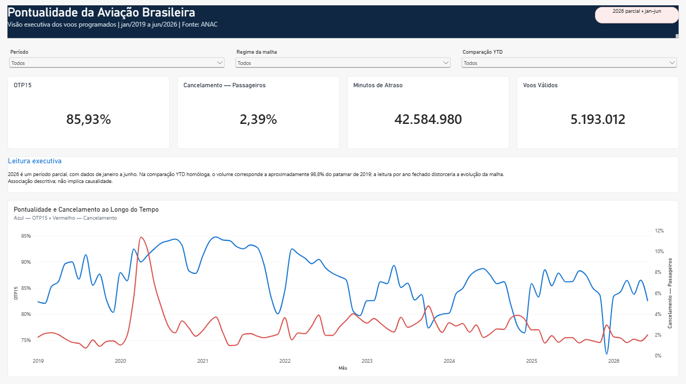
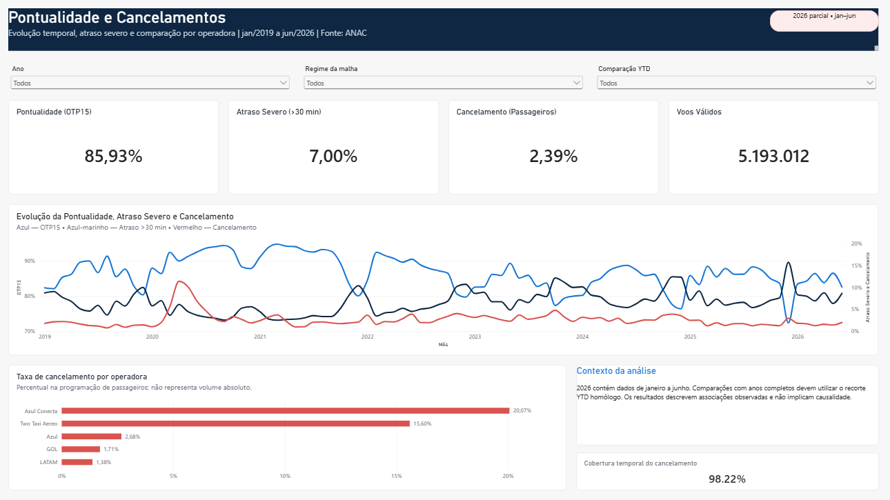
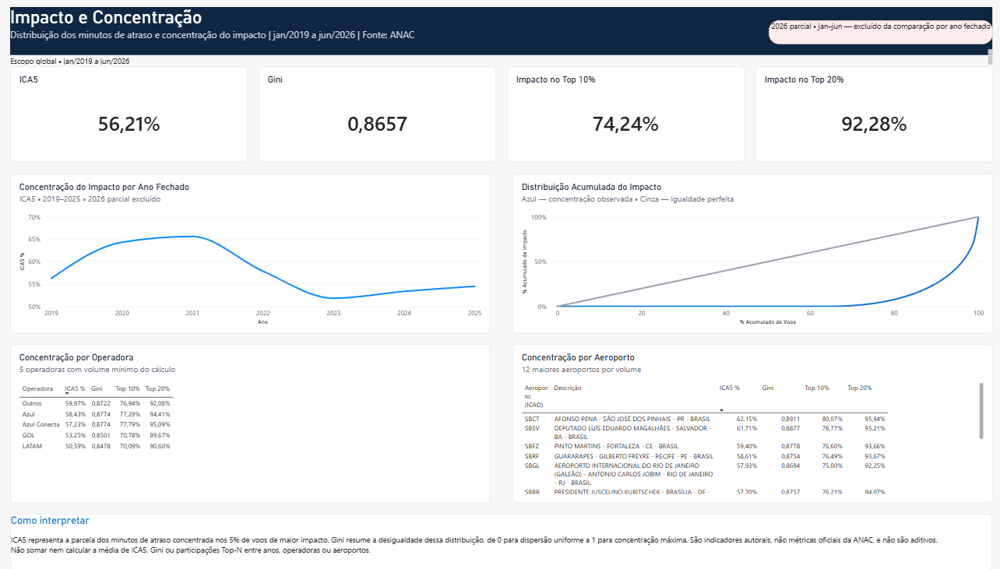

# Pontualidade da Aviação Doméstica Brasileira

Análise diagnóstica da concentração de atrasos na malha aérea doméstica
brasileira, a partir dos microdados públicos **VRA (Voo Regular Ativo)** da
ANAC.

> **Status:** Blocos **A** (universo analítico), **B** (série temporal), **C**
> (aeroporto vs companhia — H2/P3/P6), **D** (concentração), **E** (dimensões
> e intradiário — H3/H4/P8) e **F** (priorização — P11) concluídos e
> auditados. Dashboard Power BI implementado, com **3 páginas públicas**
> (`1 — Visão Executiva`, `2 — Pontualidade e Cancelamentos`,
> `3 — Impacto e Concentração`) mais a página técnica oculta
> `00 — Homologação` — ver [`powerbi/README.md`](powerbi/README.md) e
> [`docs/especificacao_powerbi.md`](docs/especificacao_powerbi.md) (§13.4).
> Detalhe do pipeline em [`docs/ROADMAP.md`](docs/ROADMAP.md) e
> [`docs/status_projeto.md`](docs/status_projeto.md).

---

## Resumo executivo

- **O quê:** pipeline Python auditável (ingestão → limpeza → 6 blocos de
  análise) sobre 5,45M voos domésticos da ANAC, mais um dashboard Power BI
  de 3 páginas públicas.
- **Pergunta central:** onde se concentra o atraso na aviação doméstica
  brasileira, e onde priorizar investimento operacional.
- **Achado principal:** 5% dos voos concentram 56,21% dos minutos de
  atraso (ICA5) — confirmado contra modelos nulos, não é artefato de
  cálculo (ver "Resultados confirmados" abaixo).
- **Rigor:** 480+ testes automatizados (regras do pipeline, contrato de
  dados e estrutura do relatório Power BI); 5 achados anteriores auditados
  e corrigidos publicamente (ver "Correções metodológicas registradas").
- **Stack:** Python, pandas, PyArrow · Power BI (PBIP/PBIR, TMDL, DAX) ·
  pytest.



---

## Objetivo

Mapear **onde** o atraso se concentra na malha doméstica e dimensionar esse
impacto, para que uma área de Performance Operacional com recursos limitados
possa priorizar intervenções por retorno esperado em minutos de atraso
evitados.

O projeto é **diagnóstico, não preditivo**, e **associativo, não causal** — o
VRA não contém meteorologia, controle de tráfego aéreo, escala de tripulação,
manutenção nem matrícula da aeronave.

### Pergunta central

> **Onde se concentra o atraso na aviação doméstica brasileira e quais pontos da
> malha oferecem maior potencial de redução do impacto operacional?**

---

## Dados

| | |
|---|---|
| **Fonte** | ANAC / SIROS — <https://siros.anac.gov.br/siros/registros/diversos/vra/> |
| **Período** | jan/2019 a jun/2026 (90 arquivos mensais) |
| **Grão** | 1 linha = 1 etapa de voo de transporte aéreo regular |
| **Base consolidada** | 6.446.620 registros × 23 colunas |
| **Universo analítico** | 5.452.295 registros × 57 colunas (doméstico, deduplicado) |
| **Licença dos dados** | dado público da ANAC |

### ⚠️ 2026 é um ano parcial

A base cobre apenas **jan–jun/2026 (6 meses)**. Lido por ano fechado, o volume
de 2026 aparece como **48,1%** do de 2019, o que sugere um colapso **que não
existe** — é meia janela. Em YTD homólogo, 2026 está em **98,8%** de 2019.

Regras em vigor, aplicáveis a qualquer leitura ou visual deste projeto:

- 2026 é sempre rotulado como **parcial**;
- comparações anuais usam **YTD homólogo** (jan–jun contra jan–jun);
- KPIs de **volume absoluto nunca** comparam 2026 com anos fechados;
- **anualizar 6 meses para 12 é proibido** — assumiria sazonalidade uniforme,
  que é justamente uma das hipóteses a testar.

### ⚠️ Nota de camada

O mesmo indicador tem valores diferentes em cada camada do pipeline. **Ao citar
um número, diga de qual camada ele vem.**

| Indicador | Camada consolidada | Universo analítico |
|---|---|---|
| Registros | 6.446.620 | 5.452.295 |
| Companhias (siglas ICAO) | 209 | 130 |
| Share Azul + LATAM + GOL | 82,49% | 92,94% |
| Mediana do atraso de partida | −1,0 min | −2,0 min |
| Média do atraso de partida | 4,8 min | 4,09 min |

Conclusões de negócio usam sempre o **universo analítico**.

---

## Arquitetura

```
data/
  raw/         90 CSVs da ANAC — camada bruta, imutável, não versionada
  interim/     vra.parquet   — consolidado e tipado, SEM limpeza
  processed/   voos.parquet  — universo analítico + campos derivados
  powerbi/     19 tabelas de consumo do dashboard — saída local gerada, ignorada pelo Git
src/
  regras.py                    fonte ÚNICA dos parâmetros analíticos
  01_ingest.py                 download idempotente e retomável
  02_consolidar.py             CSV -> Parquet (encoding e schema por arquivo)
  03_auditoria.py              descreve problemas, NÃO corrige nada
  04_universo.py               Bloco A: regras R1-R11 -> universo analítico
  05_bloco_d_concentracao.py   Bloco D: concentração, ICA5, robustez
  06_bloco_b_temporal.py       Bloco B: P1, P2, KPI 6, YTD homólogo
  07_bloco_c_aeroporto_vs_companhia.py   Bloco C: H2, P3, P6
  08_bloco_f_priorizacao.py              Bloco F: P11 (ranking, 12 meses)
  09_bloco_e_dimensoes_intradiario.py    Bloco E: H3, H4, P8, KPI 2/3/5
  10_exportar_powerbi.py                 exporta as 19 tabelas do dashboard
tests/                         testes do pipeline e do relatório Power BI (pytest)
docs/                          documentação metodológica (parte gerada por script)
powerbi/                       dashboard Power BI (PBIP/PBIR/TMDL) — ver powerbi/README.md
notebooks/ sql/ reports/       ainda vazios — ver ROADMAP
```

**Princípios de projeto**

1. **Nenhuma limpeza silenciosa.** Cada regra reporta quantos registros afeta e
   o resultado é um funil auditável (`docs/universo_analitico.md`).
2. **Colunas originais nunca são sobrescritas.** Todo tratamento cria campo
   derivado; outliers são **marcados**, não removidos.
3. **Uma regra, um lugar.** Todo limiar, recorte e agrupamento vive em
   `src/regras.py`. Duas declarações da mesma regra divergem na primeira
   alteração.
4. **Documento gerado por script.** `auditoria_qualidade.md`,
   `universo_analitico.md`, `eda_bloco_d.md` e `eda_bloco_b.md` são saídas de
   execução, não texto escrito à mão — se divergirem do código, o código é a
   verdade.
5. **Decisão de negócio não se toma no código.** Onde falta regra, o projeto
   registra a pendência e uma guarda de teste falha se alguém decidir em
   silêncio. As decisões tomadas ficam em `docs/status_projeto.md`.

---

## Reprodução

Requer **Python 3.14** (o projeto foi executado em 3.14.3).

```bash
# 1. ambiente
python -m venv .venv
.venv/Scripts/activate          # Windows;  source .venv/bin/activate no Linux
pip install -r requirements.txt

# 2. pipeline, em ordem
python src/01_ingest.py                    # ~1,8 GB de CSV; idempotente
python src/02_consolidar.py                # -> data/interim/vra.parquet
python src/03_auditoria.py                 # -> docs/auditoria_qualidade.md
python src/04_universo.py                  # -> data/processed/voos.parquet
python src/05_bloco_d_concentracao.py      # -> docs/eda_bloco_d.md
python src/06_bloco_b_temporal.py          # -> docs/eda_bloco_b.md
python src/07_bloco_c_aeroporto_vs_companhia.py   # -> docs/eda_bloco_c.md
python src/08_bloco_f_priorizacao.py              # -> docs/eda_bloco_f.md
python src/09_bloco_e_dimensoes_intradiario.py    # -> docs/eda_bloco_e.md

# 3. testes
pip install -r requirements-dev.txt
python -m pytest tests/ -v
```

Os passos 1 e 2 são os únicos custosos (o passo 2 leva ~5 min; o 4, ~40 s). Os
demais levam segundos porque operam sobre Parquet. O passo 1 pode ser
interrompido e retomado: arquivos já baixados com tamanho coerente são pulados.
A suíte de testes (480+ testes automatizados, pipeline + contrato de dados +
estrutura do relatório Power BI).

Para abrir e configurar o dashboard Power BI (parâmetro `pPowerBIDataRoot`,
obrigatório uma vez por máquina), ver [`powerbi/README.md`](powerbi/README.md)
e a seção "Power BI — Dashboard" abaixo.

---

## Power BI — Dashboard

Projeto versionável nativamente no formato **PBIP** (Power BI Project) —
modelo semântico em **TMDL**, relatório em **PBIR**, medidas em **DAX**.
Não é um `.pbix` binário: todo o relatório é texto, revisável em diff.

**Arquitetura pública final** — 3 páginas públicas, navegação **nativa por
abas** (sem Page Navigator, bookmark ou botão customizado), mais 1 página
técnica oculta:

| Página | Visibilidade | Conteúdo |
|---|---|---|
| `00 — Homologação` | oculta (`HiddenInViewMode`) | auditoria técnica — nunca aparece para o público do dashboard |
| `1 — Visão Executiva` | pública | KPIs globais de pontualidade/cancelamento, série temporal mensal |
| `2 — Pontualidade e Cancelamentos` | pública | aprofundamento por operadora, ranking de cancelamento |
| `3 — Impacto e Concentração` | pública | ICA5, Gini, curva de Lorenz, rankings de operadoras e aeroportos |





Período coberto por todas as páginas públicas: **jan/2019 a jun/2026**, com
**2026 sempre rotulado como parcial** (mesma regra da seção "Dados" acima) —
a exclusão de 2026 vale só para o gráfico de evolução por ano fechado da
página 3, nunca para os KPIs globais nem para a curva de Lorenz.

Desenho completo de cada página, medidas DAX e decisões de modelagem:
[`docs/especificacao_powerbi.md`](docs/especificacao_powerbi.md) (§13.4 para
a arquitetura pública final tal como implementada).

### Abrir o dashboard

1. Instale uma **versão atual do Power BI Desktop** com suporte a projetos
   PBIP e definições PBIR (Microsoft Store ou site oficial).
2. Abra `powerbi/PontualidadeAviacaoBR.pbip`.
3. Configure o parâmetro `pPowerBIDataRoot` (obrigatório, uma vez por
   máquina) — procedimento completo em [`powerbi/README.md`](powerbi/README.md).
4. **Atualizar dados** (Refresh) depois de configurar o parâmetro.

### Testes do relatório Power BI

Incluídos na suíte completa (`pytest -q`, seção "Reprodução" acima); para
rodar só os do relatório:

```bash
pytest tests/test_pbir_report.py -q
pytest tests/test_visao_executiva_pendencias.py -q
pytest tests/test_pontualidade_cancelamentos_pendencias.py -q
pytest tests/test_impacto_concentracao_pendencias.py -q
pytest tests/test_navegacao_consistencia_pendencias.py -q
```

Eles validam a FORMA dos arquivos texto (JSON válido, IDs únicos, ausência
de nomes técnicos visíveis, ausência de navegação customizada, nenhum
caminho absoluto fora de `pPowerBIDataRoot`) — não o comportamento do motor
do Power BI. Abrir o `.pbip` no Desktop continua sendo a única fonte de
verdade sobre layout, refresh e cálculo DAX renderizado.

---

## Resultados confirmados

Apenas o que foi medido e reproduzido. Nada aqui é conclusão de negócio final.

### H1 — o atraso está concentrado numa fração pequena dos voos: **CONFIRMADA**

Universo de cálculo: 5.193.012 voos domésticos realizados com atraso de partida
válido. Impacto = `max(atraso_partida_min, 0)`, total de 42.584.980 minutos.

| Recorte | Share do impacto total |
|---|---|
| Top 1% dos voos | **25,74%** |
| **Top 5% dos voos (ICA5)** | **56,21%** |
| Top 10% dos voos | 74,24% |
| Top 20% dos voos | 92,28% |

Coeficiente de Gini do impacto: **0,8657**. Voos com impacto > 0: 34,71%.

**Robustez verificada em quatro eixos:**

| Eixo | Amplitude do ICA5 |
|---|---|
| Por ano (2019–2026) | 51,8% – 65,6% |
| Por operadora analítica | 50,6% – 60,0% |
| Por grupo econômico | 50,6% – 60,0% |
| Pelos 12 maiores aeroportos | 45,0% – 62,2% |
| Por corte de outliers (6 h → sem corte) | 53,8% – 56,7% |

**A concentração não é artefato de cálculo.** Contra modelos nulos com a mesma
proporção de voos atrasados e a mesma média (`eda_bloco_d.md`, D.7): piso
mecânico imposto só pelos zeros = 14,40%; referência exponencial = 42,32%;
observado = 56,21%. Mesmo excluindo todos os voos pontuais, os atrasos
observados seguem mais concentrados que uma exponencial (Gini 0,6131 vs 0,5001).

### P1 e KPI 6 — série temporal (Bloco B)

**Por que o YTD homólogo não é opcional.** Lido por ano fechado, 2026 aparece
com **48,1%** do volume de 2019 — um colapso de metade da malha que **não
existe**. Lido em YTD homólogo (jan–jun contra jan–jun), 2026 está em **98,8%**.
A queda era só a metade da janela faltando.

**OTP15 em YTD homólogo (jan–jun de cada ano):**

| Ano | Voos | OTP15 | >30 min | >60 min | Mediana | Regime |
|---|---|---|---|---|---|---|
| 2019 | 392.814 | 85,79% | 7,09% | 2,71% | 0,0 | pré-pandemia |
| 2020 | 215.110 | 88,90% | 5,52% | 2,23% | −1,0 | pandemia |
| 2021 | 216.112 | **93,28%** | 3,18% | 1,45% | −4,0 | pandemia |
| 2022 | 336.539 | 89,77% | 4,97% | 2,03% | −3,0 | recuperação |
| 2023 | 384.022 | 85,32% | 7,14% | 2,62% | −1,0 | pós-recuperação |
| 2024 | 377.554 | 85,54% | 7,26% | 2,95% | −2,0 | pós-recuperação |
| 2025 | 388.991 | 86,22% | 6,93% | 2,83% | −2,0 | pós-recuperação |
| 2026* | 389.066 | **84,53%** | 7,82% | 3,06% | −2,0 | pós-recuperação |

`*` ano parcial. Amplitude: **8,75 pp**. O melhor OTP15 ocorre durante a
pandemia, com a malha em ~55% do volume — **associação** entre volume e
pontualidade, não prova de que reduzir voos melhora pontualidade.

**KPI 6 — cancelamento em YTD:** de **1,78%** (2026) a **3,64%** (2020).

**P2 — a concentração mudou?** Não desapareceu em nenhum ano. É mais alta na
pandemia e mais baixa com a malha cheia; a correlação entre volume mensal e
concentração é **−0,741** (Pearson, 90 meses). Correlação, não mecanismo.

### Correções metodológicas registradas

| Achado anterior | Situação |
|---|---|
| "5% concentram 59,7%; 1% concentra 30,8%" | **Superestimado.** Calculado na base não tratada, com internacionais. Valores corretos: **56,21%** e **25,74%** |
| "48,6% dos voos partem antecipados" | **Errado.** Artefato de cortar em zero uma distribuição centrada em zero. Com faixa simétrica: **83,55% pontuais**, apenas **1,55% antecipados** (> 15 min) |
| *Schedule padding* crescente | **Refutado.** 552 rotas, 2019 vs 2025: duração prevista +0,0 min (mediana) |
| "103.392 duplicatas (1,60%)" | **Resolvido.** 98,8% era artefato de `NaN == NaN`; duplicatas reais = 1.266 na base completa |
| Média de "5,8 min" | **Não reproduzível.** Base completa = 4,8 min; universo tratado = **4,09 min** |

### KPIs

Dos 9 KPIs definidos em `docs/definicao_do_case.md`, **sete estão
implementados com cálculo dedicado**: KPI 1 (OTP15), KPI 2 (taxa de atraso
>30/>60 min), KPI 3 (mediana), KPI 4 (ICA5), KPI 5 (minutos acumulados), KPI 6
(cancelamento) e KPI 7 (recuperação em voo) — KPI 2/3/5 por dimensão (Bloco E,
`eda_bloco_e.md`). KPI 8 (volume/participação) e KPI 9 (atraso médio,
secundário por definição) aparecem de forma incidental nas tabelas do Bloco B
e na nota de camada acima, sem seção dedicada própria.

> **ICA5 é indicador autoral deste projeto.** Não é métrica da ANAC nem padrão
> de mercado, e deve sempre ser apresentado com a definição visível.

### H2, P3, P6 — aeroporto vs companhia (Bloco C)

**H2 — o aeroporto pesa mais que a companhia? Resultado depende do escopo,**
reportado sem escolher um número único:

| Variante | razão aeroporto/grupo |
|---|---|
| Todos os operadores | 0,40 (operadora pesa mais) |
| Azul/LATAM/GOL por operadora analítica | 1,66 (aeroporto pesa mais) |
| Azul/LATAM/GOL por grupo econômico | 1,97 (aeroporto pesa mais) |

A conclusão troca de sinal segundo a inclusão ou não do bucket heterogêneo
"Outros" — ver `docs/eda_bloco_c.md`, seção C.2, para a decomposição completa.

**P6** (Azul × LATAM × GOL por aeroporto × faixa de 3 h): células com menos de
100 voos são sinalizadas na tabela, nunca removidas.

**P11:** ver seção própria abaixo (Bloco F) — o ranking real usa horizonte e
corte de célula diferentes dos propostos em C.7 (que ficam como contexto
histórico).

### H3, H4, P8 — dimensões e intradiário (Bloco E)

Horizonte: histórico completo (2019–2026), mesmo raciocínio de H2.

**H3 — não refutada.** A taxa de atraso >15 min varia **13,76 pp** ao longo
do dia: mínimo às 5h (5,37%), máximo às 22h (19,13%). A curva cresce da manhã
à noite, com uma queda na madrugada profunda (poucos voos, ainda sem acúmulo
do dia).

**H4 — não refutada.** A razão entre share de minutos de atraso e share de
voos, nos 116 aeroportos com volume ≥ 1.000, varia de **0,18 a 3,94** — muito
longe da proporcionalidade que refutaria a hipótese. SBGR, o maior aeroporto
do universo, também é desproporcional (razão 1,24): o achado não é só ruído
de aeroporto pequeno.

**Limite declarado:** a curva intradiária (H3) é compatível com efeito
**cascata** (atraso que se propaga entre voos da mesma aeronave) **e** com
**saturação de infraestrutura** (mais voos programados à tarde/noite). As
duas explicações não são separáveis sem matrícula da aeronave.

### P11 — priorização operacional (Bloco F)

**Decisão D5:** o ranking usa os **últimos 12 meses completos**
(jul/2025–jun/2026), não o histórico inteiro — que fica só como teste de
estabilidade. Corte de célula recalculado para essa janela
(`VOLUME_MINIMO_CELULA_P11 = 500`, não o corte de 1.000 do histórico
completo). Das 625 células aeroporto × `faixa_3h` da janela, **234 são
elegíveis**, representando **94,0%** dos voos e **94,3%** dos minutos de
atraso.

Cinco critérios de elegibilidade avaliados — volume mínimo, cobertura de
partidas válidas e meses de operação **excluem**; estabilidade entre
subperíodos e concentração por operadora são **flags visíveis na tabela**,
nunca exclusão automática.

**Sem índice composto:** dois rankings paralelos — por **impacto total**
(minutos acumulados, a pergunta de P11) e por **taxa** (OTP15, do pior para o
melhor) — que produzem listas diferentes (sobreposição de 5 em 10 no topo).
Cancelamento nunca é convertido em minutos. Detalhe completo, com as duas
tabelas de topo 10 e o teste de estabilidade contra o histórico, em
`docs/eda_bloco_f.md`.

---

## Limitações

1. **Dado observacional.** Todas as relações são **associações**, não causas.
2. **Sem identificador da aeronave.** A base traz o modelo, não a matrícula —
   **nenhum teste de efeito cascata é possível**.
3. **2026 é parcial** (6 meses) — ver regras acima.
4. **Quebra estrutural em 2020–2021**; comparações cruzam regimes distintos.
5. **`justificativa` preenchida em 6,31%** — análise de causa declarada é
   indicativa, jamais representativa.
6. **`numero_assentos` inválido** em 3,47% do recorte, com invalidez
   concentrada em "Outros" (27,38%) — inviabiliza métricas de oferta.
7. **Domínios de `codigo_di` e `codigo_tipo_linha` não publicados** pela ANAC.
8. **`codeshare` ausente em 57 dos 90 arquivos** — inviável como série.
9. **Nenhuma métrica financeira** — o VRA não tem receita, custo nem tarifa.
10. **A taxa de cancelamento agregada mistura naturezas de operação** —
    passageiros cancelam 1,99%, carga 9,64% e táxi aéreo 24,06%. Decisão D3
    **aprovada**: o headline do KPI 6 passou a ser só passageiros; carga,
    táxi aéreo, não classificado e a visão agregada seguem publicados como
    sensibilidade (seção KPI6.0 de `docs/eda_bloco_b.md`), nunca escondidos.
11. **2,79% dos voos (151.969) têm segmento operacional não classificado.**
    Auditados por Pareto: 96,11% concentrados em 4 códigos de passageiros
    conhecidos fora da fonte (PTB/PAM/ONE/IPM), não reclassificados por falta
    de marcador textual verificável na razão social — ver `status_projeto.md`,
    seção D3.
12. **Vigência de companhia é datada pela razão social na fonte**, que é limite
    *superior* do evento societário: a dimensão afirma vigência de nome, não
    data de aquisição. Resolvida por **registro** (razão social do próprio
    voo), não por vigência mensal — a versão mensal misclassificava o mês de
    transição.
13. **Horário local por aeroporto não confirmado pela fonte** — `faixa_3h` e
    `periodo_dia` comparam `hora_prevista` entre aeroportos sem confirmação de
    que estejam no mesmo fuso horário. Evidência empírica é favorável, não
    documental. Ver `LIMITACAO_FUSO_HORARIO` em `src/regras.py`.

---

## Estágio atual e próximos passos

| Etapa | Estado |
|---|---|
| Ingestão, consolidação, auditoria de qualidade | ✅ concluído |
| Bloco A — universo analítico (R1–R11) | ✅ concluído |
| Bloco D — concentração e ICA5 | ✅ concluído e auditado |
| Bloco B — série temporal (P1, P2, KPI 6) | ✅ concluído |
| Bloco C — aeroporto vs companhia (H2, P3, P6) | ✅ concluído |
| **Bloco E — dimensões e intradiário (H3, H4, P8, KPI 2/3/5)** | ✅ **concluído** |
| **Bloco F — priorização (P11)** | ✅ **concluído** |
| Governança (git, README, roadmap, 480+ testes automatizados) | ✅ concluído |
| Validade da chegada / KPI 7 (decisão D1) | ✅ implementado e reconciliado |
| Dimensão de companhia com vigência por registro (decisão D2) | ✅ implementado (corrigido nesta rodada) |
| Escopo de operador / headline do KPI 6 (decisão D3) | ✅ implementado — `nao_classificado` (2,79%) segue sem reclassificação por falta de evidência |
| Faixa horária `faixa_3h`/`periodo_dia` (decisão D4) | ✅ implementado |
| Volumes mínimos separados por finalidade (decisão D4.1) | ✅ implementado |
| Horizonte e elegibilidade do P11 (decisão D5) | ✅ implementado |
| Dashboard Power BI (Bloco G) — 3 páginas públicas + `00` oculta | ✅ concluído — ver "Power BI — Dashboard" acima; publicação (push do repositório) ainda pendente |

Sequência detalhada em [`docs/ROADMAP.md`](docs/ROADMAP.md).

---

## Documentação

| Arquivo | Conteúdo | Origem |
|---|---|---|
| [`docs/definicao_do_case.md`](docs/definicao_do_case.md) | problema de negócio, 12 perguntas, 8 hipóteses, 9 KPIs | escrito |
| [`docs/dicionario_dados.md`](docs/dicionario_dados.md) | 23 colunas da fonte + derivadas, problema por coluna | escrito |
| [`docs/ROADMAP.md`](docs/ROADMAP.md) | blocos da EDA, o que cada um responde | escrito |
| [`docs/status_projeto.md`](docs/status_projeto.md) | estado verificado, decisões pendentes, riscos | escrito |
| [`docs/auditoria_qualidade.md`](docs/auditoria_qualidade.md) | qualidade da camada consolidada | **gerado** por `03_auditoria.py` |
| [`docs/universo_analitico.md`](docs/universo_analitico.md) | funil auditável das regras R1–R11 | **gerado** por `04_universo.py` |
| [`docs/eda_bloco_d.md`](docs/eda_bloco_d.md) | concentração, ICA5, robustez, modelos nulos | **gerado** por `05_bloco_d_concentracao.py` |
| [`docs/eda_bloco_b.md`](docs/eda_bloco_b.md) | série temporal, OTP15, YTD homólogo, KPI 6 (headline D3) | **gerado** por `06_bloco_b_temporal.py` |
| [`docs/eda_bloco_c.md`](docs/eda_bloco_c.md) | aeroporto vs companhia, decomposição de variância (H2), P3, P6 | **gerado** por `07_bloco_c_aeroporto_vs_companhia.py` |
| [`docs/eda_bloco_f.md`](docs/eda_bloco_f.md) | priorização operacional (P11): elegibilidade, rankings paralelos, teste de estabilidade | **gerado** por `08_bloco_f_priorizacao.py` |
| [`docs/eda_bloco_e.md`](docs/eda_bloco_e.md) | dimensões e intradiário: H3, H4, P8, KPI 2/3/5 | **gerado** por `09_bloco_e_dimensoes_intradiario.py` |
| [`docs/especificacao_powerbi.md`](docs/especificacao_powerbi.md) | especificação técnica do modelo semântico e do relatório Power BI — páginas, medidas DAX, arquitetura pública final (§13.4) | escrito |

---

## Licença

Código e documentação deste repositório são autorais e distribuídos sob a
licença **MIT** (ver [`LICENSE`](LICENSE)).

Os **dados** não são redistribuídos por este repositório — nenhum CSV ou
Parquet é versionado no Git. Os microdados **VRA** são obtidos diretamente da
**ANAC** (ver seção "Dados" acima) e permanecem sujeitos aos termos da fonte
oficial; a licença MIT deste repositório cobre o código e a documentação, não
os dados de origem.
